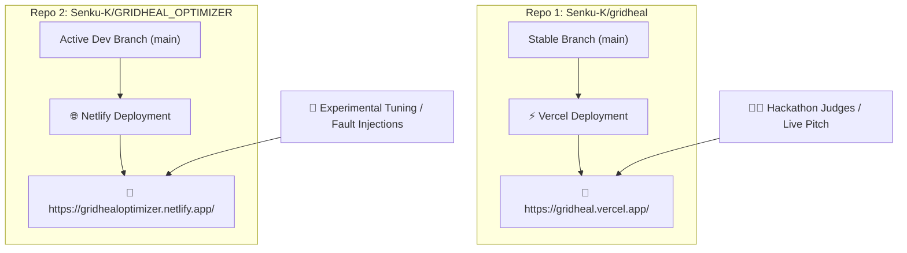

# ⚡ GridHeal: Dual-Prototype Architecture & Deployment Flow

> **"A microgrid is an operating system for electricity. GridHeal is the scheduler."**  
> *Team lulzsec • Bharati Vidyapeeth's College of Engineering*  
> *Prompt-ae-thon | Sustainability & Smart Cities (PS4: Self-Healing Renewable Energy Grid)*

---

## 🎯 Core Strategy: Why Two Separate Deployments?

To ensure **zero downtime during live evaluations while continuing rapid iteration**, we separated the project into two distinct environments backed by independent GitHub repositories and cloud providers:

---

## 🌐 1. Production Pitch Prototype (Vercel)

- **Live URL:** [https://gridheal.vercel.app/](https://gridheal.vercel.app/)
- **GitHub Repository:** [https://github.com/Senku-K/gridheal](https://github.com/Senku-K/gridheal)
- **Role:** **Stable Judge-Facing Demo**
- **Purpose:** 
  - Kept strictly reliable with locked parameters for presentations and pitch judging.
  - Used for the **6-Step Guided Walkthrough Tour** to explain how GridHeal eliminates critical power downtime.
  - Guarantees 100% uptime on Vercel's global edge network.

---

## 🧪 2. Optimization & Staging Lab Prototype (Netlify)

- **Live URL:** [https://gridhealoptimizer.netlify.app/](https://gridhealoptimizer.netlify.app/)
- **GitHub Repository:** [https://github.com/Senku-K/GRIDHEAL_OPTIMIZER](https://github.com/Senku-K/GRIDHEAL_OPTIMIZER)
- **Role:** **Active Experimentation & Tuning Sandbox**
- **Purpose:**
  - Where we test extreme fault stress tests (multi-inverter trips, battery thermal cuts, EV demand spikes).
  - Used for modifying dispatch constants (`src/sim/config.ts`), adjusting look-ahead forecast horizons, and refining UI features.
  - Auto-builds directly via `netlify.toml` whenever updates are pushed from the CLI.

---

## 🔄 The 4-Stage Control Flow Under the Hood

Both prototypes run the deterministic **GridHeal Control Loop** every 15-minute simulation step:

1. **Detect (Telemetry Audit):**
   - Continuously monitors solar generation, battery State-of-Charge (SoC), and bus voltage to spot anomalies.
2. **Predict (Forecast Look-Ahead):**
   - Applies a 4-step lookahead uncertainty cone forecasting solar drops and evening peak loads before they impact the grid.
3. **Reallocate (Priority Scheduling):**
   - Allocates power based on priority queues: **P0 (Critical Labs/Servers)** $\rightarrow$ **P1 (EVs & Pumps shifted to solar hours)** $\rightarrow$ **P2 (Deferrable thermal loads on surplus only)**.
4. **Recover (Fault Isolation & Islanding):**
   - Isolates faulty hardware branches in $<1$ second and islands critical loads, guaranteeing **0 minutes of critical downtime**.

---

## 📊 Benchmark Targets Delivered

| Metric | Baseline Controller | GridHeal Controller | Design Target |
| :--- | :--- | :--- | :--- |
| **Critical-Load Downtime** | 105 min (Blackout) | **0 min (100% Protected)** | **0 min** |
| **Fault to Re-plan Time** | ~3 min (Manual) | **0.14 ms (Real-time)** | **< 1 s** |
| **Peak Demand Shaved** | 362 kW | **317.6 kW (-44.4 kW)** | Shaved |
| **CO₂ Avoided (7 Days)** | 0 kg | **2,175 kg Avoided** | Maximized |
